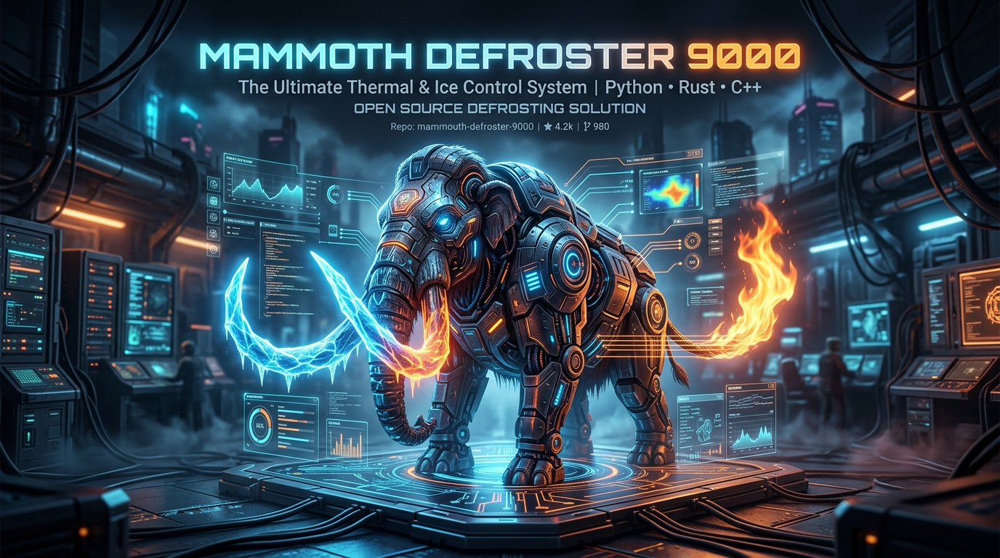
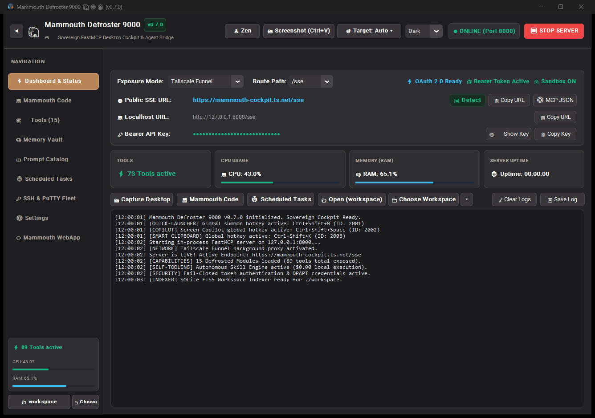
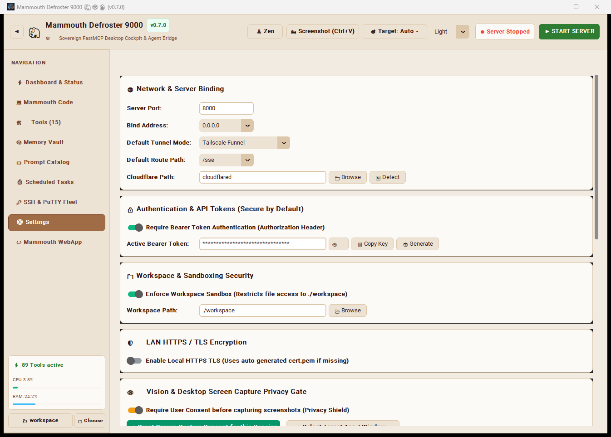
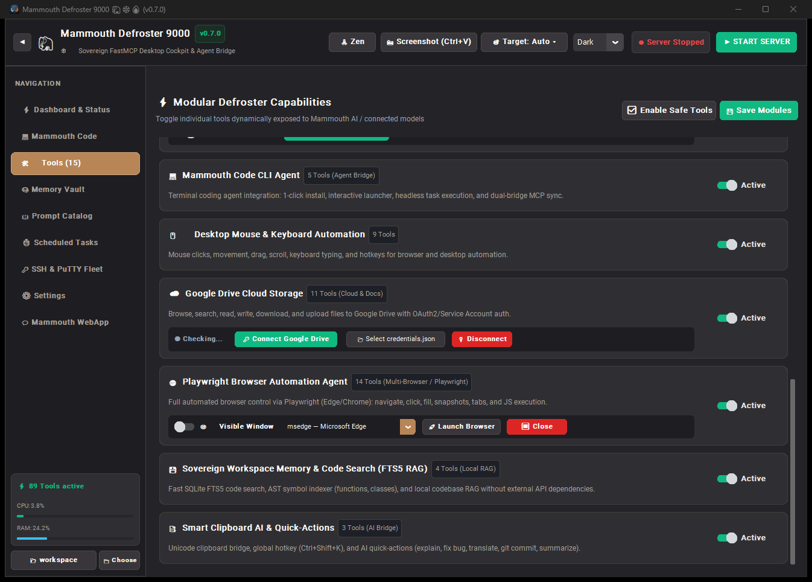

<p align="center">
  
</p>

<p align="center">
  <a href="https://github.com/hellforgex/Mammouth-Defroster-9000/releases"></a>
  
  
  
  
</p>

<h3 align="center">🦣 Thawing 10,000 years of frozen Windows automation power for <a href="https://mammouth.ai">Mammouth.ai</a>. 🔥</h3>

**Mammouth Defroster 9000 (MD-9000)** is a desktop cockpit and MCP server that connects your [Mammouth.ai](https://mammouth.ai) assistant to your Windows PC. Your assistant can look at your screen (with your consent), drive mouse and keyboard, work on files in a sandboxed workspace, automate a browser, manage SSH hosts, check your hardware and run the Mammouth Code CLI — every module can be switched on or off in the GUI.

<p align="center">
  
</p>

**Contents:** [Quickstart](#-quickstart) · [Connect to Mammouth.ai](#-connect-to-mammouthai) · [Exposure modes](#-exposure-modes) · [Safety defaults](#%EF%B8%8F-safety-defaults) · [What's new](#-whats-new-in-v070) · [Modules](#%EF%B8%8F-modules--tools) · [FAQ](#-faq) · [Developers](#-for-developers) · [Disclaimer](#%EF%B8%8F-disclaimer)

---

## 🚀 Quickstart

No Python, Git or terminal needed — the release is a self-contained package.

1. **Download** [`MammouthDefroster9000-v0.7.0-windows-x64.zip`](https://github.com/hellforgex/Mammouth-Defroster-9000/releases/latest) (~128 MB).
2. **Extract** it anywhere, e.g. `C:\MammouthDefroster9000`.
3. **Start** `start_gui.bat` (or `MammouthDefroster9000.exe`).
4. **Pick an exposure mode** ([see below](#-exposure-modes)) and click **`▶ Start Server`**.

---

## 🔗 Connect to Mammouth.ai

1. In the cockpit, click **`📋 Copy Endpoint`** (e.g. `https://your-pc.ts.net/sse`) and **`📋 Copy Key`** (your Bearer token).
2. In [Mammouth.ai](https://mammouth.ai) open **Settings ⚙️ → Custom MCP Servers → Add MCP Server**:

   | Field | Value |
   | :--- | :--- |
   | Name | `Mammouth Defroster 9000` |
   | Type | `SSE` (recommended) or `Streamable HTTP` |
   | URL | your endpoint, ending in `/sse` (or `/mcp` for Streamable HTTP) |
   | Bearer Token | your copied key |

3. Save, start a new chat — Mammouth discovers the enabled tools automatically.

---

## 🌐 Exposure Modes

Mammouth.ai runs in the cloud, so it has to reach your PC. Every mode except LAN makes the server reachable **from the public internet**; it is then protected by the Bearer token only. Use the least exposure that works for you.

| Mode | Reachable from | Setup | Notes |
| :--- | :--- | :---: | :--- |
| **Tailscale Funnel** ⭐ | Public internet | Easy | Stable `https://<node>.ts.net/sse` address, TLS by Tailscale. Recommended for everyday use. |
| **Cloudflare Quick Tunnel** | Public internet | None | Bundled `cloudflared`, temporary `https://<id>.trycloudflare.com/sse` address. Good for a quick test. |
| **ngrok** | Public internet | Easy | Needs your ngrok authtoken; supports custom domains. |
| **Direct LAN IP** | Your local network only | None | `http://192.168.x.x:8000/sse`. Only works if the client is in your network. |

Tunnels are **never started automatically** unless you enable `auto_tunnel` yourself.

---

## 🛡️ Safety Defaults

<p align="center">
  
</p>

| Default | What it means |
| :--- | :--- |
| **Bearer token required** | Every endpoint enforces token authentication (`enforce_auth`). |
| **Bound to `127.0.0.1`** | The server only listens locally until you choose an exposure mode. |
| **Workspace sandbox** | File tools are confined to `./workspace`. |
| **PowerShell & daemons off** | Shell execution is disabled until you switch it on in the GUI. |
| **Web scraper off** | Disabled by default; when enabled, an SSRF shield blocks private networks and cloud metadata endpoints. |
| **Screen consent gate** | Every screenshot needs your approval (once / session / revoke). The model cannot grant consent itself — those functions are not exposed as tools. |
| **Admin shell off** | `allow_admin_shell` is `false` by default. |
| **Encrypted secrets** | SSH hosts and tokens are stored with Windows DPAPI. |

> ⚠️ Once you enable **PowerShell & daemons**, commands run with your user rights **outside** the workspace sandbox. Only enable it if you trust the prompts you send.

---

## ✨ What's New in v0.7.0

- **Self-tooling:** If no built-in tool fits, the assistant can write its own Python or PowerShell script into `workspace/skills/` and run it locally. Running a script costs no API tokens; writing it does. Requires the **PowerShell & daemons** module.
- **`defroster_catalog`:** Token-budget-friendly tool discovery for Mammouth's on-demand mode — the model looks up tools by category or search term instead of loading all schemas at once.
- **Multi-browser agent:** Playwright with Chromium, Firefox and WebKit plus detection of installed Edge, Chrome and Brave. The model can switch engine and headless mode via `browser_restart`.
- **Persistent browser logins:** Cookies and LocalStorage are saved per browser channel (`data/browser_states/`), so web logins survive restarts.
- **Security fix:** Stricter workspace containment for `type` and `findstr` in the shell module.

Full history: [`CHANGELOG.md`](CHANGELOG.md) · [`RELEASE_NOTES.md`](RELEASE_NOTES.md)

---

## 🛠️ Modules & Tools

<p align="center">
  
</p>

15 switchable modules with 97 tools, plus the always-on `defroster_catalog`. Defaults as shipped in `config.example.json`.

| Module | Default | Tools | What it does | Key tools |
| :--- | :---: | :---: | :--- | :--- |
| 🌐 Browser Agent | ✅ on | 15 | Playwright automation: navigate, click, fill, DOM snapshot, screenshots, tabs, persistent logins | `browser_navigate`, `browser_snapshot`, `browser_click`, `browser_fill`, `browser_restart` |
| 👁️ Desktop Vision | ✅ on | 7 | Multi-monitor and window screenshots, tracked window, hotkey `Ctrl+Shift+Space` — behind the consent gate | `screen_capture`, `screen_capture_active_window`, `screen_list_windows` |
| 🖱️ Mouse & Keyboard | ✅ on | 9 | Win32 mouse moves, clicks, drag & drop, scrolling, Unicode typing, hotkeys | `mouse_click`, `mouse_drag`, `keyboard_type`, `keyboard_hotkey` |
| 💻 Mammouth Code CLI | ✅ on | 5 | Install/update, launch and run headless tasks with the Mammouth Code CLI; sync MCP config | `mammouth_code_run_task`, `mammouth_code_sync_mcp` |
| ☁️ Google Drive | ✅ on | 11 | List, search, read, write, upload and download Drive files (OAuth2 or service account) | `gdrive_search_files`, `gdrive_read_file`, `gdrive_upload_from_workspace` |
| 🔎 Workspace Search | ✅ on | 4 | Local SQLite FTS5 index of your code, symbol search, incremental updates | `workspace_index_directory`, `workspace_search`, `workspace_find_symbols` |
| 📑 Smart Clipboard | ✅ on | 3 | Clipboard read/write and AI quick actions, hotkey `Ctrl+Shift+K` | `clipboard_get_text`, `clipboard_transform` |
| 🧠 Long-Term Memory | ✅ on | 5 | Notes and context that survive across chats; Knowledge Vault tab in the GUI | `memory_save`, `memory_recall`, `memory_list` |
| 📋 Tasks & Kanban | ✅ on | 4 | Task board with `todo` / `in_progress` / `done` / `blocked` | `task_create`, `task_update`, `task_list` |
| ⏱️ Task Scheduler | ✅ on | 5 | Recurring prompts for Mammouth chat, Mammouth Code or local scripts | `task_schedule_create`, `task_schedule_control` |
| 📁 File & Code Ops | ✅ on | 6 | Read, write, patch, search and list files inside `./workspace` | `file_read`, `file_write`, `file_replace_chunk`, `file_search_text` |
| 🔑 PuTTY & SSH | ✅ on | 6 | Run commands and transfer files on saved SSH hosts (plink / pscp), DPAPI-encrypted host store | `ssh_exec_command`, `ssh_transfer_file`, `ssh_list_saved_hosts` |
| 📊 System Diagnostics | ✅ on | 5 | CPU, RAM, disks, GPU, processes, Windows event logs | `system_get_specs`, `system_get_processes`, `system_get_event_logs` |
| 💻 PowerShell & Daemons | ⛔ off | 9 | PowerShell / cmd execution and background processes — **not sandboxed** | `powershell_exec`, `command_run`, `process_start_background` |
| 🌐 Web Scraper | ⛔ off | 2 | Fetch pages as Markdown, check endpoint status (SSRF shield) | `web_fetch_url`, `web_check_status` |

Global hotkey to summon the cockpit: `Ctrl+Shift+M`.

---

## ❓ FAQ

<details>
<summary><b>Do I need Python?</b></summary>
<p>No. The release ZIP contains everything. Python is only needed if you run from source.</p>
</details>

<details>
<summary><b>How do I enable PowerShell?</b></summary>
<p>In the cockpit, open <b>Capabilities / Skills</b> and switch on <b>PowerShell &amp; Background Daemons</b>. Commands then run with your user rights outside the workspace sandbox.</p>
</details>

<details>
<summary><b>Where does my data go?</b></summary>
<p>MD-9000 has no telemetry and no server of its own. Tool results — including screenshots you approve — go to your Mammouth.ai chat and from there to the model provider you use in Mammouth. With a tunnel, traffic also passes through that tunnel provider (Tailscale, Cloudflare or ngrok).</p>
</details>

<details>
<summary><b><code>/sse</code> or <code>/mcp</code>?</b></summary>
<p><code>/sse</code> is the default and recommended. <code>/mcp</code> (Streamable HTTP) works as well; both require the Bearer token.</p>
</details>

<details>
<summary><b>How do I stop the server?</b></summary>
<p>Click <b><code>⏹ Stop Server</code></b> or close the cockpit window.</p>
</details>

---

## 💻 For Developers

```bash
# Run from source
git clone https://github.com/hellforgex/Mammouth-Defroster-9000.git
cd Mammouth-Defroster-9000
uv run gui.py

# Headless server (console with live logs)
.\MammouthDefroster9000-server.exe   # or .\start_server.bat

# Build GUI + CLI binaries and the release ZIP
.\build.bat
```

### Project structure

```
├── server.py              # FastMCP server: auth, CORS, tool registration
├── gui.py                 # CustomTkinter desktop cockpit
├── config.py              # Config manager, DPAPI token encryption
├── tray_manager.py        # System tray integration
├── modules/
│   ├── browser_agent.py   # Playwright multi-browser agent
│   ├── screen_capture.py  # Desktop vision + consent gate
│   ├── desktop_input.py   # Win32 mouse & keyboard
│   ├── mammouth_code.py   # Mammouth Code CLI integration
│   ├── google_drive.py    # Google Drive
│   ├── workspace_indexer.py  # Local FTS5 code search
│   ├── smart_clipboard.py # Clipboard + quick actions
│   ├── memory.py          # Long-term memory (SQLite)
│   ├── tasks_kanban.py    # Tasks & Kanban (SQLite)
│   ├── task_scheduler.py  # Recurring automations
│   ├── file_ops.py        # Sandboxed file operations
│   ├── shell_processes.py # PowerShell & background daemons
│   ├── putty_ssh.py       # PuTTY / plink / pscp
│   ├── system_monitor.py  # Hardware & event logs
│   ├── web_tools.py       # Web scraper with SSRF shield
│   ├── embedded_browser.py  # WebView2 Mammouth chat in the cockpit
│   ├── global_hotkey.py   # Win32 global hotkeys
│   └── updater.py         # Update check
├── config.example.json    # Template configuration (copy to config.json)
├── hosts.example.json     # Template SSH hosts
├── build.bat · MammouthDefroster9000.spec   # PyInstaller build
├── start_gui.bat · start_server.bat
└── assets/                # Banner, screenshots, icons
```

Security reports: see [`SECURITY.md`](SECURITY.md).

---

## ⚠️ Disclaimer

> [!CAUTION]
> **Vibecoded by noskillz — with great agentic power comes great responsibility.**
>
> You are handing an AI assistant real keys to your machine: file changes, desktop input, remote SSH servers and — if you enable it — PowerShell. Never expose the server to the internet without the Bearer token. Test your prompts, keep your workspace sandboxed, and remember: if you tell an AI to *"clean up everything"* and it deletes your favorite meme stash, that is between you, the AI and the cosmos. 🚀

## ⚖️ Legal Disclaimer & Limitation of Liability

> [!IMPORTANT]
> **Please read carefully before deploying or operating this software:**
>
> 1. **Gratuitous Provision ("As-Is" / Statutory Basis)**:  
>    This software is provided as an open-source project entirely free of charge on an **"as-is"** and **"as-available"** basis without warranties of any kind, either express or implied. Under governing statutory law for gratuitous software provision (including Section 521 of the German Civil Code / BGB), the legal liability of the author and developer (**noskillz / hellforgex**) is strictly limited to **intentional misconduct** (*Vorsatz*) and **gross negligence** (*grobe Fahrlässigkeit*). Any liability for ordinary, slight, or simple negligence is expressly excluded to the fullest extent permitted by applicable law.
>
> 2. **Sole Risk and Operator Responsibility**:  
>    The execution and utilization of all functions within this software—specifically modules executing local **PowerShell commands**, **file system modifications (writing, modifying, deleting)**, **system diagnostics**, **desktop input/vision automation**, and **remote SSH/VPS server operations (PuTTY / Plink / PSCP)**—is undertaken strictly at the user's sole risk. The operator assumes full and exclusive liability for all actions, scripts, and operations initiated by themselves or triggered by connected AI models and autonomous agents.
>
> 3. **Exclusion of Consequential Damages & Data Loss**:  
>    The author/developer shall not be held liable for any direct, indirect, incidental, special, consequential, or punitive damages, including but not limited to loss of data, corrupted databases, hardware damage, operating system crashes, downtime, security breaches, unauthorized third-party access, or financial losses resulting from the installation, execution, or network exposure of this software.
>
> 4. **Network and Tunnel Security**:  
>    The operator is solely responsible for properly configuring and securing all network interfaces, reverse proxies, and tunnel endpoints (e.g. via Tailscale VPN, private network isolation, firewalls, or token authentication). Exposing this server to the public internet without adequate authentication is performed entirely at the user's own peril.

---

## 📄 License

MIT License — Copyright (c) 2026 **noskillz** ([hellforgex](https://github.com/hellforgex)). See [`LICENSE`](LICENSE) and the legal disclaimer above.
