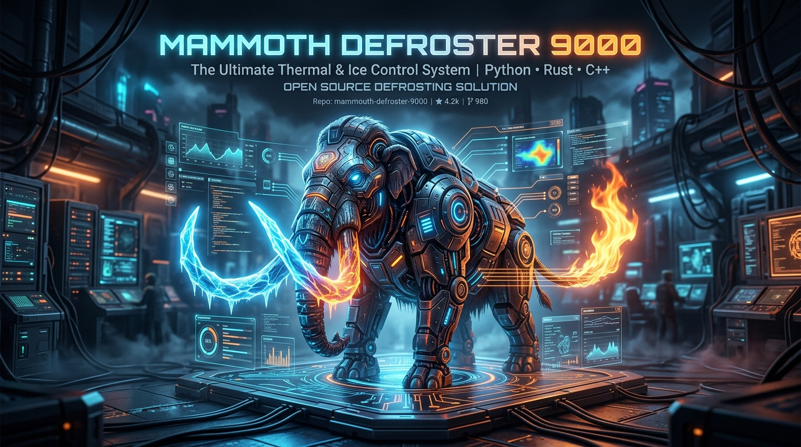
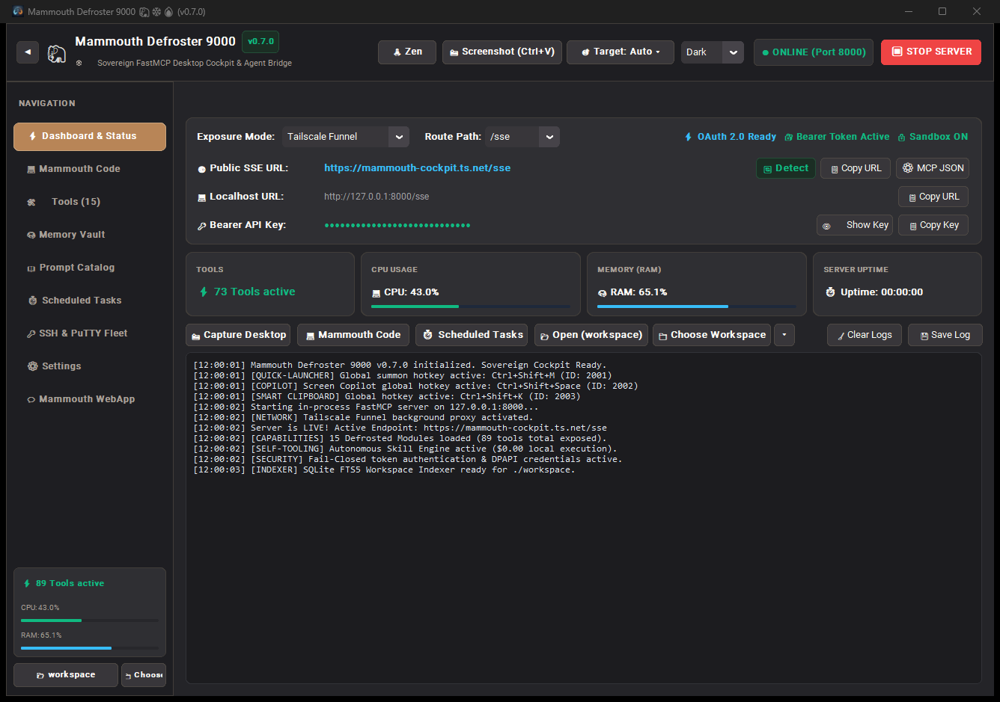
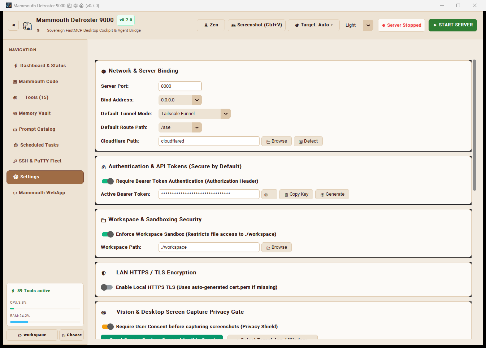
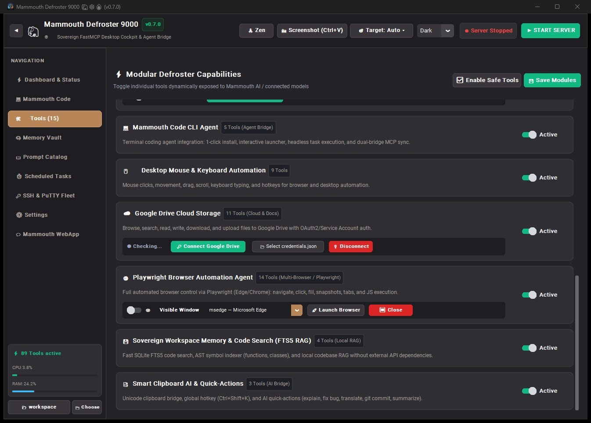

<p align="center">
  
</p>

<p align="center">
  <a href="https://github.com/hellforgex/Mammouth-Defroster-9000/releases"></a>
  
  
  
  
</p>

<h3 align="center">🦣 Thawing 10,000 years of frozen Windows automation power for ChatGPT, Claude, Gemini, &amp; <a href="https://mammouth.ai">Mammouth.ai</a>. 🔥</h3>

**Defrostr (formerly Mammouth Defroster 9000)** is a multi-provider desktop cockpit and MCP server that connects **ChatGPT**, **Claude**, **Google Gemini**, and **[Mammouth.ai](https://mammouth.ai)** to your Windows PC. Your assistant can look at your screen (with your consent), drive mouse and keyboard, work on files in a sandboxed workspace, automate a browser, manage SSH hosts, check your hardware and run CLI coding agents — and you choose in **Settings** which provider tabs appear in the cockpit and manage all security controls in the dedicated **Security** tab.

<p align="center">
  
</p>

**Contents:** [Quickstart](#-quickstart) · [Connect to ChatGPT, Claude, Gemini or Mammouth.ai](#-connect-to-chatgpt-claude-gemini-or-mammouthai) · [Exposure modes](#-exposure-modes) · [Safety defaults](#%EF%B8%8F-safety-defaults) · [What's new](#-whats-new-in-v090-cumulative-since-v082) · [Modules](#%EF%B8%8F-modules--tools) · [FAQ](#-faq) · [Developers](#-for-developers) · [Disclaimer](#%EF%B8%8F-disclaimer)

---

## 🚀 Quickstart

No Python, Git or terminal needed — the release is a self-contained package.

1. **Download** [`MammouthDefroster9000-v0.9.0-windows-x64.zip`](https://github.com/hellforgex/Mammouth-Defroster-9000/releases/latest) (~133 MB).
2. **Extract** it anywhere, e.g. `C:\MammouthDefroster9000`.
3. **Start** `start_gui.bat` (or `MammouthDefroster9000.exe`).
4. **Pick an exposure mode** ([see below](#-exposure-modes)) and click **`▶ Start Server`**.

---

## 🔗 Connect to ChatGPT, Claude, Gemini or Mammouth.ai

### Google Gemini (Developer Mode / OAuth 2.1 — Works in EU/DE via English Profile)
> **Important for EU / Germany / non-US users:** Google hides custom MCP connectors on localized (e.g. German) Gemini pages. Defrostr's built-in **✨ Gemini Web** tab runs in an isolated English (`en-US`) WebView2 profile pointing directly to `https://gemini.google.com/devmode?hl=en` — and automatically returns to `/devmode?hl=en` after Google sign-in — so MCP connectors stay unlocked!

1. Start a public HTTPS tunnel (e.g., **Tailscale Funnel** or **Cloudflare Tunnel**) and click **`✨ Gemini URL`** on the Dashboard.
2. Open the built-in **✨ Gemini Web** tab (or click **`🌐 Open in Browser`** on its toolbar if you are already signed into Google in your regular desktop browser — that opens [`https://gemini.google.com/devmode?hl=en`](https://gemini.google.com/devmode?hl=en) immediately; inside Defrostr, you can also click **`🧪 DevMode`** anytime after signing in if Google redirects to `/app`). Make sure Gemini Apps Activity is turned on and you use a personal 18+ Google account.
3. In **Choose an app**, click **`+ Create new`**, paste the copied `/mcp` URL, and leave **OAuth Client ID & Secret** blank (Defrostr uses Dynamic Client Registration + PKCE `S256`).
4. Click **Connect**, enter your **Bearer API Key** from the Dashboard on Defrostr's OAuth dialog, and click **Allow Access**.

### Claude (Web Connectors / OAuth 2.1)
1. Start a public HTTPS tunnel (e.g., **Tailscale Funnel** or **Cloudflare Tunnel**) and click **`🟠 Claude URL`** on the Dashboard.
2. In [Claude](https://claude.ai) open **Settings → Connectors → Add custom connector** and paste the copied `/mcp` URL (leave **OAuth Client ID & Secret** blank — Defroster uses Dynamic Client Registration + PKCE `S256`).
3. Click **Connect**, enter your **Bearer API Key** from the Dashboard on Defroster's OAuth dialog, and click **Allow Access**.
4. Use the built-in **🟠 Claude Web** tab directly in the Cockpit with screenshots (`Ctrl+V`), global hotkeys, and scheduled tasks!

### ChatGPT (Developer Mode / MCP Connectors)
1. Start a public HTTPS tunnel (e.g., **Tailscale Funnel** or **Cloudflare Tunnel**) and click **`🤖 ChatGPT URL`** on the Dashboard.
2. In [ChatGPT](https://chatgpt.com) open **Settings → Apps & Connectors → Advanced settings → Developer mode** and create a new MCP Connector.
3. Paste the copied `/mcp` URL and choose **OAuth** authentication — Defroster handles Dynamic Client Registration and OAuth 2.1 + PKCE (`S256`) automatically.
4. Use the built-in **🤖 ChatGPT Web** tab directly in the Cockpit with screenshots (`Ctrl+V`), global hotkeys, and scheduled tasks!

### Mammouth.ai
1. In the cockpit, click **`📋 Copy URL`** (e.g. `https://your-pc.ts.net/sse`) and **`📋 Copy Key`** (your Bearer token).
2. In [Mammouth.ai](https://mammouth.ai) open **Settings ⚙️ → Custom MCP Servers → Add MCP Server**:

   | Field | Value |
   | :--- | :--- |
   | Name | `Mammouth Defroster 9000` |
   | Type | `SSE` (recommended) or `Streamable HTTP` |
   | URL | your endpoint, ending in `/sse` (or `/mcp` for Streamable HTTP) |
   | Bearer Token | your copied key |

3. Save, start a new chat — Mammouth discovers the enabled tools automatically.

---

## 🌐 Exposure Modes

Mammouth.ai runs in the cloud, so it has to reach your PC. Every mode except LAN makes the server reachable **from the public internet**; it is then protected by the Bearer token only. Use the least exposure that works for you.

| Mode | Reachable from | Setup | Notes |
| :--- | :--- | :---: | :--- |
| **Tailscale Funnel** ⭐ | Public internet | Easy | Stable `https://<node>.ts.net/sse` address, TLS by Tailscale. Recommended for everyday use. |
| **Cloudflare Quick Tunnel** | Public internet | None | Bundled `cloudflared`, temporary `https://<id>.trycloudflare.com/sse` address. Good for a quick test. |
| **ngrok** | Public internet | Easy | Needs your ngrok authtoken; supports custom domains. |
| **Direct LAN IP** | Your local network only | None | `http://192.168.x.x:8742/sse`. Only works if the client is in your network. |

Tunnels are **never started automatically** unless you enable `auto_tunnel` yourself.

---

## 🛡️ Safety Defaults

<p align="center">
  
</p>

| Default | What it means |
| :--- | :--- |
| **Bearer token required** | Every endpoint enforces token authentication (`enforce_auth`). |
| **Bound to `127.0.0.1`** | The server only listens locally until you choose an exposure mode (default port `8742`). |
| **Workspace sandbox** | File tools are confined to `./workspace`. |
| **Secret-file shield** | `file_read` and `file_search_text` block/skip `.env`, tokens, SSH keys, `oauth.db`, and Defroster `config.json` / `hosts.json` by default (`protect_secret_files`). |
| **PowerShell & daemons off** | Shell execution is disabled until you switch it on in the GUI (`allow_shell_downloads` stays off unless explicitly enabled). |
| **Web scraper off** | Disabled by default; when enabled, an SSRF shield blocks private networks and cloud metadata endpoints. |
| **Screen consent gate** | Every screenshot needs your approval (once / session / revoke). The model cannot grant consent itself — those functions are not exposed as tools. |
| **Admin shell off** | `allow_admin_shell` is `false` by default. |
| **Encrypted secrets** | SSH hosts, OAuth tokens, and API tokens are stored with Windows DPAPI. |

> ⚠️ Once you enable **PowerShell & daemons**, commands run with your user rights **outside** the workspace sandbox. Only enable it if you trust the prompts you send.

---

## ✨ What's New in v0.9.0 (Cumulative since v0.8.2)

- **Built-In Google Gemini WebApp (`✨ Gemini Web`) & English Profile (v0.9.0):**
  - Added a dedicated **✨ Gemini Web** cockpit tab with an isolated `en-US` WebView2 profile (`./data/gemini_browser_profile`), launching directly at `https://gemini.google.com/devmode?hl=en` with a toolbar **`🧪 DevMode`** shortcut so EU/non-US users can unlock Gemini Developer Mode MCP connectors effortlessly.
  - Added exact Google Gemini OAuth 2.1 callback validation (`oauth-redirect.googleusercontent.com`, `oauth-redirect-sandbox.googleusercontent.com`, `oauth-redirect-test.googleusercontent.com`, `vertexaisearch.cloud.google.com`, `gemini.google.com`), CORS/CSP `frame-ancestors`, a **`✨ Gemini URL`** 1-click onboarding dialog, Quill editor prompt injection, and `gemini_web` scheduled task support.

Since `v0.7.5`, Defroster has expanded into a multi-assistant cockpit with a streamlined 42-tool MCP architecture and tighter secret hygiene:

- **Claude Connector Ergonomics & Secret Hygiene (v0.8.2):**
  - **Secret-file read protection (`protect_secret_files: true`):** `file_read` refuses credential/token files (`.env`, `credentials.json`, `gdrive_token.json`, `oauth.db`, SSH private keys, `config.json`, `hosts.json`) and `file_search_text` skips them while keeping `*.example` / `*.sample` templates readable.
  - **Optional MCP tool annotations (`expose_tool_annotations`):** Adds `readOnlyHint`, `destructiveHint`, `idempotentHint`, and `openWorldHint` metadata when enabled (`false` by default for strict MCP 2024-11-05 clients).
  - **Windows `known_folders` & bounded listings:** `system_get_specs` reports OneDrive-aware shell folders (`desktop`, `documents`, `downloads`, etc.) and `directory_list` bounds flat listings via `max_entries` (default `500`).
  - **New default port `8742` & opt-in shell downloads (`allow_shell_downloads`):** Avoids port 8000 collisions on fresh installs and lets elevated shell users explicitly opt into `irm`/`iwr`/`curl`/`wget` downloads while keeping stagers/LOLBins permanently blocked.
- **Embedded Claude WebApp & Streamlined 42-Tool Architecture (v0.8.1):**
  - Parallel **🟠 Claude Web** (`claude.ai`) tab alongside **🤖 ChatGPT Web** and **💬 Mammouth AI Web** with isolated WebView2 profiles, OAuth 2.1 DCR onboarding, and `claude_web` task triggers.
  - Consolidated 106 MCP tools into **42 canonical action-dispatched tools** (-47% wire tokens) with transparent legacy aliases in `defroster_execute_tool`.
- **ChatGPT Integration & Task Scheduler Reliability (v0.8.0):**
  - Embedded **🤖 ChatGPT Web** tab (`chatgpt.com`), OpenAI OAuth 2.1 redirect/DCR/PKCE `S256` support, and background `TaskSchedulerEngine` execution loop.

Full history: [`CHANGELOG.md`](CHANGELOG.md) · [`RELEASE_NOTES.md`](RELEASE_NOTES.md)

---

## 🛠️ Modules & Tools

<p align="center">
  
</p>

16 switchable modules (39 module tools) plus 3 always-on core hub tools (`defroster_catalog`, `defroster_health_check`, `defroster_execute_tool`) = **42 streamlined tools**. Defaults as shipped in `config.example.json`.

| Module | Default | Tools | What it does | Canonical tools |
| :--- | :---: | :---: | :--- | :--- |
| 🌐 Browser Agent | ✅ on | 5 | Playwright automation: navigate, DOM/screenshot inspect, click/fill/scroll, JS eval, tabs & engines | `browser_navigate`, `browser_inspect`, `browser_interact`, `browser_evaluate`, `browser_session` |
| 📁 File & Code Ops | ✅ on | 5 | Read, write, patch, search and list files inside `./workspace` with secret-file protection | `file_read`, `file_write`, `file_replace_chunk`, `file_search_text`, `directory_list` |
| ☁️ Google Drive | ✅ on | 4 | List, search, read, download, write, upload and manage Drive files (OAuth2 or service account) | `gdrive_list`, `gdrive_read`, `gdrive_write`, `gdrive_manage` |
| 🖱️ Mouse & Keyboard | ✅ on | 3 | Screen geometry, Win32 mouse moves/clicks/drag/scroll, Unicode typing and hotkeys | `desktop_get_screen_info`, `desktop_mouse`, `desktop_keyboard` |
| 📊 System Diagnostics | ✅ on | 3 | CPU, RAM, disks, GPU, `known_folders`, top processes and Windows event logs | `system_get_specs`, `system_get_processes`, `system_event_logs` |
| 🧠 Long-Term Memory | ✅ on | 3 | Notes and semantic recall that survive across chats; Knowledge Vault tab in the GUI | `memory_save`, `memory_recall`, `memory_delete` |
| 👁️ Desktop Vision | ✅ on | 2 | Multi-monitor and window screenshots, tracked window, hotkey `Ctrl+Shift+Space` — behind the consent gate | `screen_capture`, `screen_windows` |
| ⏱️ Task Scheduler | ✅ on | 2 | Recurring prompts for ChatGPT, Claude, Mammouth chat, CLI or local scripts | `task_schedule_create`, `task_schedule_manage` |
| 🔎 Workspace Search | ✅ on | 1 | Local SQLite FTS5 index of your code, symbol search, incremental updates | `workspace_code_search` |
| 📑 Smart Clipboard | ✅ on | 1 | Clipboard read/write/clean and AI quick actions, hotkey `Ctrl+Shift+K` | `clipboard_manage` |
| 📋 Tasks & Kanban | ✅ on | 1 | Task board with `todo` / `in_progress` / `done` / `blocked` | `task_board` |
| 🤖 Claude Code CLI | ✅ on | 1 | Claude Code CLI & cloud sessions status, `.mcp.json` sync, terminal launcher and task runner | `claude_code` |
| 💻 PowerShell & Daemons | ⛔ off | 3 | PowerShell / cmd execution, `desktop_open`, and background processes — **not sandboxed** | `powershell_exec`, `desktop_open`, `process_manage` |
| 🔑 PuTTY & SSH | ⛔ off | 3 | Run commands and transfer files on saved SSH hosts (plink / pscp), DPAPI-encrypted host store | `ssh_hosts`, `ssh_exec_command`, `ssh_transfer_file` |
| 💻 Mammouth Code CLI | ⛔ off | 1 | Install/update, sync MCP config, launch terminal and run headless tasks with Mammouth Code CLI | `mammouth_code` |
| 🌐 Web Scraper | ⛔ off | 1 | Fetch pages as Markdown and check endpoint status (SSRF shield) | `web_fetch` |

Global hotkey to summon the cockpit: `Ctrl+Shift+M`.

---

## ❓ FAQ

<details>
<summary><b>Do I need Python?</b></summary>
<p>No. The release ZIP contains everything. Python is only needed if you run from source.</p>
</details>

<details>
<summary><b>How do I enable PowerShell?</b></summary>
<p>In the cockpit, open <b>Capabilities / Skills</b> and switch on <b>PowerShell &amp; Background Daemons</b>. Commands then run with your user rights outside the workspace sandbox.</p>
</details>

<details>
<summary><b>Where does my data go?</b></summary>
<p>MD-9000 has no telemetry and no server of its own. Tool results — including screenshots you approve — go only to the assistant you connected (ChatGPT, Claude, or Mammouth.ai) and from there to its model provider. With a tunnel, traffic also passes through that tunnel provider (Tailscale, Cloudflare or ngrok).</p>
</details>

<details>
<summary><b><code>/sse</code> or <code>/mcp</code>?</b></summary>
<p><code>/sse</code> is the default for Mammouth.ai; <code>/mcp</code> (Streamable HTTP + OAuth 2.1) is recommended for ChatGPT and Claude connectors. Both enforce authentication.</p>
</details>

<details>
<summary><b>How do I stop the server?</b></summary>
<p>Click <b><code>⏹ Stop Server</code></b> or close the cockpit window.</p>
</details>

---

## 💻 For Developers

```bash
# Run from source
git clone https://github.com/hellforgex/Mammouth-Defroster-9000.git
cd Mammouth-Defroster-9000
uv run gui.py

# Headless server (console with live logs)
.\MammouthDefroster9000-server.exe   # or .\start_server.bat

# Build GUI + CLI binaries and the release ZIP
.\build.bat
```

### Project structure

```
├── server.py              # FastMCP server: auth, CORS, tool registration
├── gui.py                 # CustomTkinter desktop cockpit
├── config.py              # Config manager, DPAPI token encryption
├── tray_manager.py        # System tray integration
├── modules/
│   ├── browser_agent.py   # Playwright multi-browser agent
│   ├── screen_capture.py  # Desktop vision + consent gate
│   ├── desktop_input.py   # Win32 mouse & keyboard
│   ├── claude_code.py     # Claude Code CLI & cloud session sync
│   ├── mammouth_code.py   # Mammouth Code CLI integration
│   ├── google_drive.py    # Google Drive
│   ├── workspace_indexer.py  # Local FTS5 code search
│   ├── smart_clipboard.py # Clipboard + quick actions
│   ├── memory.py          # Long-term memory (SQLite)
│   ├── tasks_kanban.py    # Tasks & Kanban (SQLite)
│   ├── task_scheduler.py  # Recurring automations
│   ├── file_ops.py        # Sandboxed file operations
│   ├── shell_processes.py # PowerShell & background daemons
│   ├── putty_ssh.py       # PuTTY / plink / pscp
│   ├── system_monitor.py  # Hardware & event logs
│   ├── web_tools.py       # Web scraper with SSRF shield
│   ├── embedded_browser.py  # WebView2 ChatGPT, Claude & Mammouth tabs in the cockpit
│   ├── global_hotkey.py   # Win32 global hotkeys
│   └── updater.py         # Update check
├── config.example.json    # Template configuration (copy to config.json)
├── hosts.example.json     # Template SSH hosts
├── build.bat · MammouthDefroster9000.spec   # PyInstaller build
├── start_gui.bat · start_server.bat
└── assets/                # Banner, screenshots, icons
```

Security reports: see [`SECURITY.md`](SECURITY.md).

---

## ⚠️ Disclaimer

> [!CAUTION]
> **Vibecoded by noskillz — with great agentic power comes great responsibility.**
>
> You are handing an AI assistant real keys to your machine: file changes, desktop input, remote SSH servers and — if you enable it — PowerShell. Never expose the server to the internet without the Bearer token. Test your prompts, keep your workspace sandboxed, and remember: if you tell an AI to *"clean up everything"* and it deletes your favorite meme stash, that is between you, the AI and the cosmos. 🚀

## ⚖️ Legal Disclaimer & Limitation of Liability

> [!IMPORTANT]
> **Please read carefully before deploying or operating this software:**
>
> 1. **Gratuitous Provision ("As-Is" / Statutory Basis)**:  
>    This software is provided as an open-source project entirely free of charge on an **"as-is"** and **"as-available"** basis without warranties of any kind, either express or implied. Under governing statutory law for gratuitous software provision (including Section 521 of the German Civil Code / BGB), the legal liability of the author and developer (**noskillz / hellforgex**) is strictly limited to **intentional misconduct** (*Vorsatz*) and **gross negligence** (*grobe Fahrlässigkeit*). Any liability for ordinary, slight, or simple negligence is expressly excluded to the fullest extent permitted by applicable law.
>
> 2. **Sole Risk and Operator Responsibility**:  
>    The execution and utilization of all functions within this software—specifically modules executing local **PowerShell commands**, **file system modifications (writing, modifying, deleting)**, **system diagnostics**, **desktop input/vision automation**, and **remote SSH/VPS server operations (PuTTY / Plink / PSCP)**—is undertaken strictly at the user's sole risk. The operator assumes full and exclusive liability for all actions, scripts, and operations initiated by themselves or triggered by connected AI models and autonomous agents.
>
> 3. **Exclusion of Consequential Damages & Data Loss**:  
>    The author/developer shall not be held liable for any direct, indirect, incidental, special, consequential, or punitive damages, including but not limited to loss of data, corrupted databases, hardware damage, operating system crashes, downtime, security breaches, unauthorized third-party access, or financial losses resulting from the installation, execution, or network exposure of this software.
>
> 4. **Network and Tunnel Security**:  
>    The operator is solely responsible for properly configuring and securing all network interfaces, reverse proxies, and tunnel endpoints (e.g. via Tailscale VPN, private network isolation, firewalls, or token authentication). Exposing this server to the public internet without adequate authentication is performed entirely at the user's own peril.

---

## 📄 License

MIT License — Copyright (c) 2026 **noskillz** ([hellforgex](https://github.com/hellforgex)). See [`LICENSE`](LICENSE) and the legal disclaimer above.
